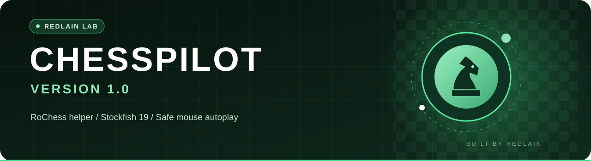
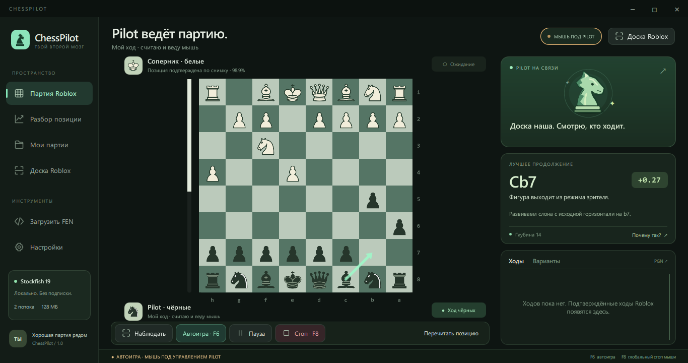
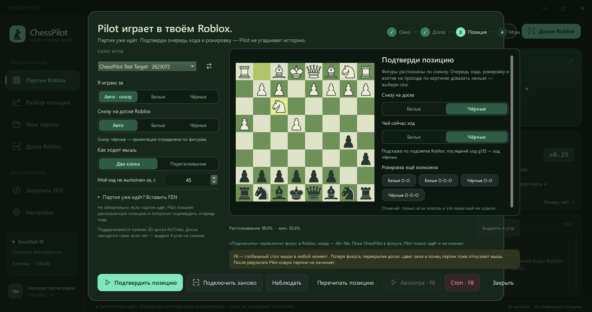
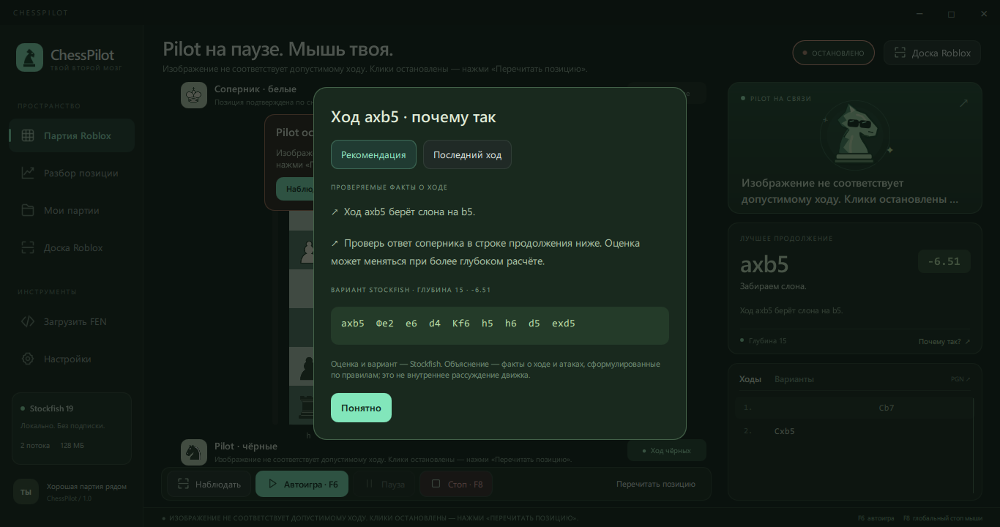
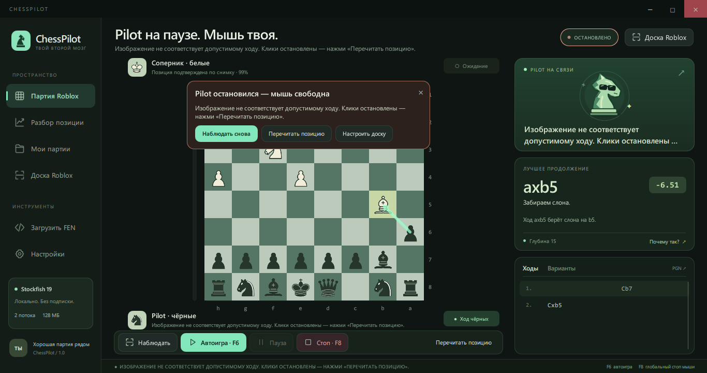

 

**See the board. Think with Stockfish. Move the mouse safely.**

A desktop chess helper built by REDLAIN for RoChess in Roblox.

**[⬇️ Download](https://github.com/REDLAIN228/ChessPilot/releases/latest)** · **[🚀 Quick start](#-quick-start)** · **[✨ Features](#-features)** · **[📚 Documentation](#-documentation)** · **[💬 Devlog](https://t.me/redlain_devlog)**

---

## ✦ About

**ChessPilot** watches the RoChess board on your screen, asks the **Stockfish 19** engine for the best move and plays it with ordinary Windows mouse input. No injection, memory reading, client modification or hidden game APIs: only screen capture and the mouse.

If anything looks wrong, Pilot lets go of the mouse instead of guessing. That includes an unclear board, lost focus, a moved window, an unfamiliar menu or the end of the game.

> **Important:** ChessPilot is meant for RoChess bots and analysis. Using it against real people is unfair and may break Roblox or RoChess rules, which can get an account banned. A strong engine does not guarantee a win in every game.

## ✨ Features

| | Feature | Details |
|:--:|---|---|
| 👁️ | **Reads the real board** | Screen capture only. Side and orientation are detected automatically, and every position is confirmed over several frames |
| 🧠 | **Stockfish 19, locally** | No internet or subscription. The engine gets the full game history, so repetitions count, and shows the three best lines |
| 🖱️ | **Plays with the mouse** | Two clicks or drag. Castling, en passant and promotion to any piece, with the promotion menu order read from the screen. Every move is confirmed on the board |
| 🛑 | **Stops by itself** | **F8** releases the mouse at any moment. Lost focus, a moved window, a covered board and the end of the game stop the clicks too. It never starts a new game on its own |
| 💬 | **Honest «Why?»** | Checkable facts about the move (what it takes, attacks or checks), never presented as the engine's inner thoughts |
| 📚 | **Keeps your games** | Every game is saved as PGN, and a saved game can be continued after a restart |

## 🚀 Quick start

**Ready-made program (no Python needed):**

1. Download **[ChessPilot-1.0-win64.zip](https://github.com/REDLAIN228/ChessPilot/releases/latest)** from Releases.
2. Extract the **whole** `ChessPilot` folder, keeping `_internal` next to the EXE, and run **`ChessPilot.exe`**. For the desktop, make a shortcut rather than moving the EXE.
3. In Roblox open **RoChess** and start a game.
4. In ChessPilot press **«Подключить»** and pick the Roblox window. Side and orientation default to automatic.
5. In the game press **F6** to start autoplay.

**F6** starts autoplay · **F8** is the emergency stop. Settings, games and logs stay in the `data` folder next to the EXE.

> Windows SmartScreen may warn about an unknown publisher because the EXE has no paid code signature. Choose «Подробнее» → «Выполнить в любом случае».

## 📚 Documentation

| Guide | Description |
|---|---|
| [Start here — RU](START_HERE_RU.md) | First launch, connecting to Roblox, what stops the mouse, promotion |
| [License](LICENSE.md) | Free to download and use. Copying, modifying and selling the code is not allowed |
| [Third-party notices](THIRD-PARTY-NOTICES.md) | Stockfish, Qt and other components with their own licenses and sources |

## 🔧 Built with

**Python · PySide6 / QML · Stockfish 19 · NumPy · Pillow · Windows OCR · Windows input**

ChessPilot's own code (chess rules, engine link, board recognition, input and interface) is closed source. Only the ready-made program is published. Stockfish is GPL-3.0, and its source ships with every release.

**Checked before release:** 40 automated tests, a self-test of the packaged EXE and 13 end-to-end checks with the real mouse on a test window. A live Roblox game against the RoChess bot Jasper (800) ended in a win by mate, with no clicks after the result.

## 💬 Follow the devlog

I'm **REDLAIN**. I experiment with Roblox development, AI tools, creative coding, and ideas that sometimes work unexpectedly well.

Find development notes, updates, free tools and real behind-the-scenes stories in **[REDLAIN / DEVLOG on Telegram](https://t.me/redlain_devlog)**.

**Made with curiosity by [@REDLAIN228](https://github.com/REDLAIN228)**

*Building · Breaking · Learning*

ChessPilot is not affiliated with Roblox Corporation or the RoChess authors.

